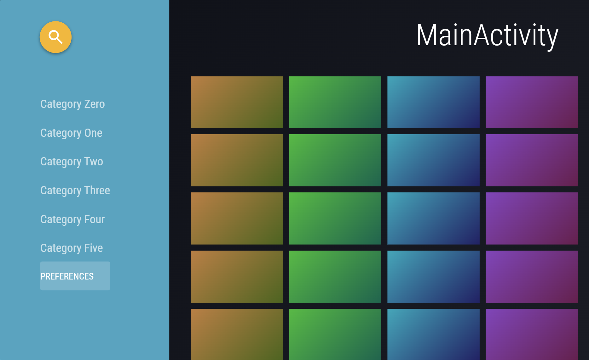
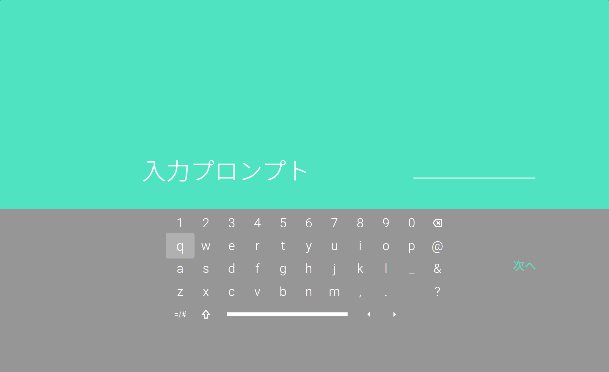

# SLUI (SmartTV Leanback UI)

A lightweight, zero-dependency (Vanilla JS) general-purpose UI component library **inspired by Leanback**, designed for Smart TV application development.
By simply loading a single `<script>` tag, you get standard Web Components optimized for 10-foot TV interfaces—featuring spatial D-pad navigation, automatic screen scaling, an on-screen keyboard, and media cards.

## 📸 Screenshots

| Main Activity | Keyboard |
| :---: | :---: |
|  |  |

## 🌐 Supported Platforms

Built purely on standard browser technologies (Custom Elements v1 / Shadow DOM), SLUI runs natively across major Smart TV web engines:

* **LG webOS™**
* **Amazon Vega OS™**
* **Android TV™**
* **Samsung Tizen™**

---

## ✨ Features

* **Minimal Code Footprint**: Complex spatial navigation (D-pad arrow key movement) and 1920×1080 auto-scaling are handled out of the box, letting you build full TV interfaces with clean, declarative HTML.
* **Truly Generic Design (MWC-Compliant)**: Components contain zero hardcoded application data or labels. Text, media, and layouts are completely injected via `<slot>` and attributes.
* **Flexible Theming via CSS Custom Properties**: Encapsulated with Shadow DOM while exposing `--ui-*` variables so you can override colors, dimensions, spacing, and animations in a single line of CSS.
* **Zero Build Step & CDN-Ready**: Works immediately by including a single `components.js` file.

---

## 🚀 Quick Start

Include `components.js` and place `<ui-screen>` and UI components inside `<ui-stage>`. Add the `focusable` attribute to any element that should receive D-pad focus.

### Example: Search & Search Results Screen (D-pad Navigation & Live Filtering)

Even a complete interactive flow—featuring an on-screen keyboard, voice trigger, real-time suggestion filtering, and multi-section results (videos, channels, and related queries)—takes only a fraction of traditional code:

```html
<!DOCTYPE html>
<html lang="en">
<head>
<meta charset="utf-8">
<meta name="viewport" content="width=device-width, initial-scale=1, viewport-fit=cover">
<title>Search / Results</title>
<script src="components.js"></script>
<style>
/* Consumer CSS: Layout positioning and CSS variable overrides only */
:root{--c:"Roboto Condensed","Roboto",sans-serif;--ui-accent:#50e3c2}
*{box-sizing:border-box;margin:0;padding:0}
html,body{height:100%;overflow:clip;background:#000;font-family:Roboto,system-ui,sans-serif;color:#fff;user-select:none}
#search,#results{background:#323232}

/* Shared Search Bar */
.orb{position:absolute;left:102px;top:52px}
.fld{position:absolute;left:356px;top:58px}

/* Search Screen: Left Keyboard / Right Suggestions */
.kb{position:absolute;left:112px;top:262px}
.sug{--ui-list-width:760px;--ui-list-header-height:84px;--ui-list-header-bg:#3a3a3a;--ui-list-header-font-size:30px;
  --ui-list-body-height:588px;--ui-list-body-bg:#b4b4b4;position:absolute;left:1040px;top:262px}
.sug ui-list-item{--ui-list-item-padding:0 40px;--ui-list-item-leading-width:72px;--ui-list-item-height:98px;--ui-list-item-highlight-width:100%;--ui-list-item-font-size:34px}
.sug ui-icon{font-size:40px;color:#6f6f6f}
.hint{position:absolute;left:112px;top:640px;font-family:var(--c);font-size:30px;color:#bcbcbc}

/* Results Screen */
.cnt{position:absolute;left:112px;top:212px;font-family:var(--c);font-size:34px;color:#bcbcbc}
.res{position:absolute;left:0;right:0;top:262px;bottom:0;overflow:hidden;padding:0 0 600px 112px}
.res ui-section{--ui-section-title-size:40px;--ui-section-title-height:52px;--ui-section-title-gap:14px}
.res ui-card[variant="dark"]{--ui-card-width:313px}
</style>
</head>
<body>
<ui-stage id="stage" style="--ui-stage-bg:#323232">

  <!-- Search Screen -->
  <ui-screen id="search">
    <ui-button variant="round-lg" class="orb" focusable data-act="mic"><ui-icon name="mic"></ui-icon></ui-button>
    <ui-field class="fld" id="fq" placeholder="Speak to search" focusable data-act="submit"></ui-field>
    <ui-keyboard class="kb" id="kb"></ui-keyboard>
    <ui-list class="sug" id="sug"><span slot="header" style="padding-left:0">Suggestions</span></ui-list>
    <div class="hint">Type with on-screen or physical keyboard / Select to search / Mic for voice</div>
  </ui-screen>

  <!-- Results Screen -->
  <ui-screen id="results">
    <ui-button variant="round-lg" class="orb" focusable data-act="back"><ui-icon name="search"></ui-icon></ui-button>
    <ui-field class="fld" id="fr" focusable data-act="back"></ui-field>
    <div class="cnt" id="cnt"></div>
    <div class="res" id="res"></div>
  </ui-screen>

  <ui-toast id="toast"></ui-toast>
</ui-stage>

<script>
const $=(s,r=document)=>r.querySelector(s),$$=(s,r=document)=>[...r.querySelectorAll(s)];
const I=(n,slot)=>`<ui-icon${slot?` slot="${slot}"`:""} name="${n}"></ui-icon>`;
const stage=$("#stage");
const el=h=>{const d=document.createElement("div");d.innerHTML=h.trim();return d.firstChild};
const toast=t=>$("#toast").show(t,1500);
let scr="search",Q="";

/* Application Data (Owned by Consumer) */
const SUG=["hello","hello world","hello adele","hello goodbye","hello kitty","hello counselor","help","helicopter","holiday","home movie"];
const VID=[["Official Video","Adele","1.0B views"],["1 HOUR Version","Orbital Music","3.5M views"],["Short Video","Kontor.TV","58M views"],["Live Session","GiraldiMedia","26M views"],["Behind the Scenes","KBS World","32K views"],["Lyric Video","The Beatles","45M views"]];
const CH=[["Adele","12M subscribers"],["Orbital Music","840K subscribers"],["Kontor.TV","2.1M subscribers"],["KBS World","3.4M subscribers"]];
const REL=["hello adele","hello goodbye","hello world","hello counselor","hello kitty"];

/* Keyboard */
function mkKey(v,html,extra=""){const k=el(`<ui-key focusable data-own ${extra}>${html}</ui-key>`);k.setAttribute("value",v);return k}
["1234567890","qwertyuiop","asdfghjkl-","zxcvbnm,.?"].forEach(r=>{
  const row=el("<ui-key-row></ui-key-row>");
  [...r].forEach(c=>{const k=mkKey(c,"");k.textContent=c;row.append(k)});
  $("#kb").append(row)});
const last=el("<ui-key-row></ui-key-row>");
last.append(mkKey("\b",I("backspace")));
last.append(mkKey(" ","","variant=\"space\" style=\"--ui-key-margin-left:0px\""));
last.append(mkKey("\n",I("search"),"data-submit"));
$("#kb").append(last);
$("#kb").addEventListener("ui-key-press",e=>{
  const k=e.detail.element,v=e.detail.value;
  if(k.hasAttribute("data-submit"))return submit();
  type(v)});
function type(c){Q=c=="\b"?Q.slice(0,-1):Q+c;sync()}

/* Suggestions */
function sync(){
  $("#fq").value=Q;
  const sug=$("#sug");
  $$("ui-list-item",sug).forEach(x=>x.remove());
  const q=Q.trim().toLowerCase();
  const a=SUG.filter(s=>!q||s.includes(q)).slice(0,6);
  a.forEach(s=>sug.append(el(`<ui-list-item focusable data-own data-q="${s}">${I("search","leading")}<span>${s}</span></ui-list-item>`)));
  if(!a.length)sug.append(el(`<ui-list-item data-own><span style="color:#6f6f6f">No matching suggestions</span></ui-list-item>`));
  const cur=stage.current;
  if(cur&&!document.contains(cur)&&scr=="search")stage.focusElement($$("ui-key",$("#kb"))[10]);
}

/* Search Results */
function renderResults(){
  const q=Q.trim()||"hello";
  $("#fr").value=q;
  $("#cnt").textContent=`Results for "${q}"`;
  const res=$("#res");res.innerHTML="";
  const s1=el(`<ui-section active><span slot="title">Videos</span></ui-section>`);
  VID.forEach((v,i)=>s1.append(el(`<ui-card variant="dark" focusable style="--ui-card-hue:${170+i*29}"><span slot="title">${q} ${v[0]}</span><span slot="subtitle">${v[1]} · ${v[2]}</span></ui-card>`)));
  const s2=el(`<ui-section><span slot="title">Channels</span></ui-section>`);
  CH.forEach((c,i)=>s2.append(el(`<ui-card variant="light" focusable style="--ui-card-hue:${(i*53+300)%360}"><span slot="title">${c[0]}</span><span slot="subtitle">${c[1]}</span></ui-card>`)));
  const s3=el(`<ui-section><span slot="title">Related Searches</span></ui-section>`);
  REL.forEach((r,i)=>s3.append(el(`<ui-tile variant="gradient" focusable data-q="${r}" style="--ui-tile-width:313px;--ui-tile-hue:${i*60+20}"><div style="padding:20px;font-size:30px;font-family:var(--c)">${r}</div></ui-tile>`)));
  res.append(s1,s2,s3);
}

/* Navigation */
function go(id){
  scr=id;
  $$("ui-screen").forEach(s=>s.toggleAttribute("active",s.id==id));
  if(id=="search"){sync();stage.focusElement($$("ui-key",$("#kb"))[10])}
  else{renderResults();stage.focusElement($("#res ui-card"))}
}
function submit(){go("results")}

/* Stage Events */
stage.addEventListener("ui-focus",e=>{
  if(scr!="results")return;
  const b=e.target.closest("ui-section");
  if(b)$$("ui-section").forEach(x=>x.toggleAttribute("active",x==b));
});
stage.addEventListener("ui-activate",e=>{
  const t=e.target,d=t.dataset;
  if(d.act=="mic"){Q="hello";sync();return toast("Voice Input")}
  if(d.act=="submit")return submit();
  if(d.act=="back")return go("search");
  if(d.q){Q=d.q;if(scr=="search"){sync();return submit()}return go("results")}
  if(t.hasAttribute("data-own"))return;
  const ti=t.querySelector('[slot="title"]');
  toast("Playing: "+(ti?ti.textContent:"Item"))});
stage.addEventListener("ui-keypress",e=>{
  if(scr!="search")return;
  const k=e.detail.key,oe=e.detail.originalEvent;
  if(k=="Backspace"){type("\b");e.preventDefault();return}
  if(k.length==1){oe.preventDefault();type(k);e.preventDefault()}});
stage.addEventListener("ui-back",()=>{if(scr=="results")go("search")});

go("search");
</script>
</body>
</html>
```

---

## 🧩 Available Components (19 Elements)

| Category | Tag Name | Description & Key Attributes / Slots |
| :--- | :--- | :--- |
| **Core & Screens** | `<ui-stage>` | Manages 1920×1080 auto-scaling and spatial D-pad focus navigation. |
| | `<ui-screen>` | Full-size screen container toggled via the `active` attribute. |
コードは注意してご使用ください。
| Navigation | <ui-rail> | Collapsible side navigation rail (collapsed attribute, leading slot). |
| | <ui-rail-item> | Menu item inside a rail (selected attribute, icon slot). |
| Content | <ui-section> | Horizontal content row with a title slot. Highlights when active. |
| | <ui-card> | Media card (variant="wide\|dark\|light\|lift\|dim\|select", media/badge/title/subtitle slots). |
| | <ui-tile> | Lightweight tile element (variant="solid\|lift\|gradient"). |
| | <ui-list> / <ui-list-item> | List container and rows (leading/trailing slots, toggle attribute). |
| Inputs & Controls | <ui-button> | Action buttons (variant="round\|round-lg\|round-accent\|filled\|text\|control", etc.). |
| | <ui-keyboard> / <ui-key-row> / <ui-key> | On-screen keyboard container, rows, and keys (value attribute, variant="label\|space"). |
| | <ui-field> | Search box / input display (value, placeholder, caret attributes). |
| | <ui-check> | Checkbox / circular check indicator (variant="circle\|box", checked attribute). |
| Utilities | <ui-progress> | Playback seek bar & control overlay (value, max attributes). |
| | <ui-panel> | Centered icon or logo frame (variant="accent"). |
| | <ui-icon> | Material Symbols icon wrapper (name attribute). |
| | <ui-toast> | Bottom notification toast (.show(text, duration) method). |

📡 Custom Events

All interactions dispatch standard CustomEvent instances with bubbles: true, composed: true, allowing centralized event handling on <ui-stage>:
• ui-focus / ui-blur: Fired when focus moves (detail: { element, previous }).
• ui-activate: Fired on Enter, Space, or click (detail: { element }).
• ui-back: Fired on Escape, Backspace, or remote Back key.
• ui-keypress: Fired on keydown (preventDefault() cancels default spatial navigation).
• ui-key-press: Fired when a <ui-key> is activated (detail: { value, element }).
• ui-select: Fired when <ui-rail> selection changes (detail: { item, index }).
• ui-change: Fired when a toggle state or field value changes.

📜 Trademarks

• LG webOS™ is a trademark or registered trademark of LG Electronics Inc.
• Amazon Vega OS™ is a trademark of Amazon.com, Inc. or its affiliates.
• Android TV™ is a trademark of Google LLC.
• Samsung Tizen™ is a trademark or registered trademark of Samsung Electronics Co., Ltd.
